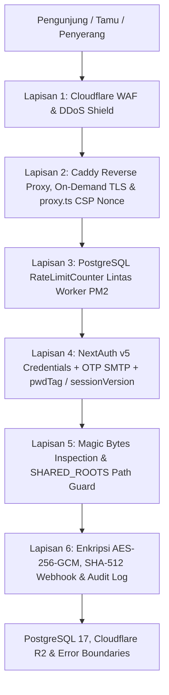

# DOKUMENTASI RESMI: KEAMANAN SISTEM & PROTEKSI DATA (SECURITY ARCHITECTURE)
**Luxenary Invite Platform — Multi-Layer Defense, Kriptografi AES-256-GCM, & Anti-Abuse Protection**

Dokumen ini membedah arsitektur keamanan (*Security Blueprint*) yang melindungi platform Luxenary Invite dari potensi eksploitasi, kebocoran data, serangan brute-force, dan manipulasi transaksi.

---

## 1. Arsitektur Pertahanan Berlapis (Defense-in-Depth)

---

## 2. Lapisan 1 & 2: Tameng Jaringan, TLS, Isolasi Domain & CSP Nonce (`proxy.ts`)

1. **Cloudflare Proxy & WAF (Awan Oranye):**
   - Menyaring serangan layer 3/4/7 DDoS sebelum mencapai server VPS.
   - Menyembunyikan alamat IP asli server VPS (`origin IP`) dari publik.
2. **Caddy On-Demand TLS:**
   - Penerbitan sertifikat SSL otomatis hanya dilakukan jika domain target diverifikasi lolos pengecekan endpoint `/api/public/resolve-custom-domain`.
   - Mencegah eksploitasi *SSL Exhaustion Attack* dari domain asing yang sengaja diarahkan ke server tanpa izin.
3. **Request Proxy Next.js 16 (`proxy.ts` — BUKAN `middleware.ts`):**
   - **Strict Subdomain & Custom Domain Isolation Guard:** Memblokir rute platform (`/admin`, `/dashboard`, `/login`, `/packages`, `/checkout`, `/api/*` non-undangan) pada custom domain (`404`) dan me-redirect rute platform pada subdomain ke apex domain.
   - **CSP Nonce Enforced per Permintaan:** Menyuntikkan nonce kriptografis pada domain apex non-admin dengan pelaporan pelanggaran ke `/api/security/csp-report`.
   - **Invalidasi Cache L1 Lintas Proses PM2:** Perubahan status/domain/pengaturan menyiarkan sinyal PostgreSQL `LISTEN/NOTIFY` (`cache_invalidate`) ke seluruh worker PM2 disertai selective custom-domain clearing di `lib/cache.ts` dan `proxy.ts`.

---

## 3. Lapisan 3: Anti-Spam & Rate Limiting Lintas Worker (`lib/rateLimit.ts`)

Mencegah serangan brute-force, spamming RSVP ucapan, dan pembebanan server berlebihan pada lingkungan PM2 cluster multi-proses:
- **Mekanisme:** `rateLimitDb` berbasis **PostgreSQL atomic UPSERT** pada tabel `rate_limit_counters` (sinkron di seluruh worker PM2 tanpa perlu Redis eksternal; otomatis fallback memori saat unit test terisolasi).
- **Ekstraksi IP Terpercaya (`getClientIp`):** Mencegah pemalsuan header `X-Forwarded-For` oleh klien.
- **Aturan Batasan Utama:**
  - Endpoint RSVP Tamu (`/api/public/rsvp`): Maksimal **10 request per menit** per IP dan **200 per menit** per undangan.
  - Endpoint Upload Foto Tamu (`/api/public/memories/upload`): Dibatasi per IP + *PostgreSQL Advisory Transaction Lock* (`pg_advisory_xact_lock`) untuk mencegah kebocoran kuota foto saat unggahan serentak.
  - Endpoint Scanner Resepsionis (`/api/receptionist/scan`): Rate limit sadar Wi-Fi gedung — **300 request per menit per IP** dan **300 request per menit per undangan** agar beberapa tablet panitia di satu NAT Wi-Fi venue tidak saling memblokir, disertai check-in atomik (`updateMany` + unique guard `P2002`).
  - Endpoint Verifikasi PIN Panitia (`/api/receptionist/verify-pin`): Maksimal **5 percobaan per IP** dan **30 per undangan** dalam 15 menit.
  - Endpoint Auth & OTP (`/api/auth/otp/request`, `/login`, `/partner`): Dibatasi ketat per IP & email untuk mencegah brute-force dan spam SMTP.

---

## 4. Lapisan 4: Enkripsi Kriptografi Dua Arah (`lib/pinEncryption.ts`)

PIN 4-digit panitia resepsionis (`staffPin`) disimpan menggunakan standar enkripsi militer:
- **Algoritma:** `AES-256-GCM` (Galois/Counter Mode) terautentikasi.
- **Vektor Inisialisasi (IV):** 16-byte cryptographically secure random bytes untuk setiap kali PIN disimpan.
- **Authentication Tag:** 16-byte auth tag untuk mendeteksi apakah ciphertext di database pernah dimanipulasi atau di-tamper.
- **Kunci Rahasia:** `PIN_ENCRYPTION_KEY` (64 karakter hex) yang disimpan di file `.env` server dan tidak pernah di-commit ke Git.
- **Manfaat:** Jika terjadi kebocoran dump database (`.sql`), penyerang tidak akan bisa membaca PIN buku tamu pengantin.

---

## 5. Lapisan 5: Validasi Magic Bytes File Unggahan & Proteksi Path Traversal

Server tidak pernah mempercayai ekstensi file (`.jpg`, `.png`) maupun header `Content-Type` yang dikirim dari browser tamu:
- Server membaca **4 hingga 12 byte biner pertama** (*magic numbers*) dari file buffer:
  - JPEG: Memeriksa header biner `FF D8 FF`.
  - PNG: Memeriksa header biner `89 50 4E 47 0D 0A 1A 0A`.
  - WebP: Memeriksa struktur biner `RIFF....WEBP`.
  - GIF: Memeriksa header biner `GIF87a` / `GIF89a`.
- File executable (`.exe`, `.sh`, `.php`), script berbahaya, atau file video yang disamarkan dengan ekstensi `.jpg` akan **langsung ditolak dengan status HTTP 400**.
- **Proteksi Path Traversal (`SHARED_ROOTS`):** Penyajian berkas statis/runtime (`lib/sharedFiles.ts`, `app/uploads/[...path]/route.ts`, `app/demo/[theme]/[file]/route.ts`, `app/portfolio/assets/[slug]/[file]/route.ts`) memvalidasi segmen path terhadap direktori root yang diizinkan dan memblokir `..`, null-byte, serta symlink escape.

---

## 6. Lapisan 6: Integritas Transaksi, Autentikasi Tanpa OAuth, RBAC & Observabilitas

1. **Verifikasi Tanda Tangan Kriptografi (Signature Validation):**
   Setiap notifikasi webhook pembayaran dari Midtrans divalidasi menggunakan hash SHA512 dengan Signature Secret Key (atau Server Key bila Signature Secret Key belum diisi), serta verifikasi `fraud_status` dan kesesuaian `grossAmount` terhadap `Order.chargedAmount`.
2. **Idempotency Protection:**
   Setiap webhook yang masuk dicatat di tabel `webhook_logs`. Jika notifikasi yang sama dikirim berulang kali oleh gateway (*retry mechanism*), sistem menjamin status transaksi tidak diproses dobel (*idempotent execution*).
3. **Autentikasi Mandiri & Pencabutan Sesi Instan:**
   - **Klien:** 100% Email + Kata Sandi (`bcrypt` cost 12) + OTP 6-digit SMTP (`email_otp_tokens`). Google OAuth & kolom `User.googleId`/`User.avatarUrl` telah dihapus permanen. Perubahan/reset kata sandi langsung membatalkan JWT lama via penanda `pwdTag`.
   - **Mitra Reseller (`/partner`):** Cookie HttpOnly bertanda tangan HMAC dengan `PartnerAffiliate.sessionVersion` untuk revokasi instan, dan tautan aktivasi klien 48 jam disimpan sebagai hash HMAC-SHA256 (`client_activation_tokens`).
   - **Admin RBAC:** Seluruh rute `/api/admin/*` diproteksi guard ganda (sesi JWT + izin modul granular per peran `SUPER_ADMIN`, `ADMIN`, `FINANCE`, `SUPPORT`). Sesi admin dicabut per akun lewat `admins.sessionVersion` setiap kali password, peran, atau izin berubah. Akun admin berpassword bawaan lama dinonaktifkan oleh seed dan hanya dapat diaktifkan lewat `scripts/set-admin-password.ts`.
   - **Remote Session & MCP Audit:** Seluruh aksi sensitif, sesi remote, dan pemanggilan Remote MCP Server (`POST /api/mcp` — Bearer API Key ter-hash SHA-256, 8 scope granular per departemen AI (tool tulis mencatat argumennya di audit; batas kupon AI dibatasi batas keras CEO yang tidak bisa diubah lewat MCP), diblokir `404` di subdomain/custom domain via `proxy.ts`, rate limit PostgreSQL per kunci, master kill-switch `mcp_enabled`, 0 kebocoran `staffPin`/`passwordHash`/kredensial) tercatat di `admin_audit_logs`.
4. **Ketahanan Error & Peringatan Operasional:**
   - React Error Boundaries (`app/error.tsx`, `app/global-error.tsx`) dan `app/not-found.tsx` mencegah layar crash mentah atau kebocoran stack trace ke pengunjung.
   - Seluruh 138 rute API terhubung ke pelacakan error terpusat (`routeError` / `forwardException`), dan kegagalan cron backup/cleanup otomatis mengirim email peringatan ke seluruh `SUPER_ADMIN` (`sendCronFailureAlertEmail`).
